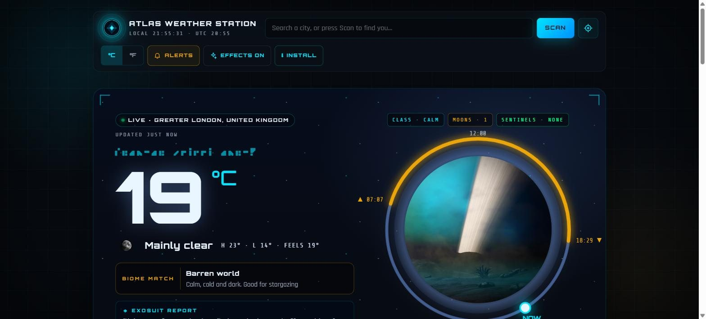
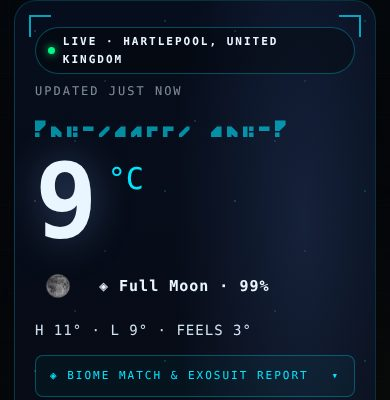
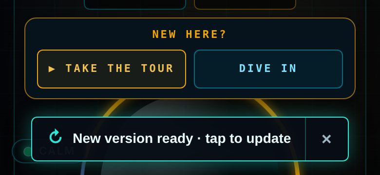
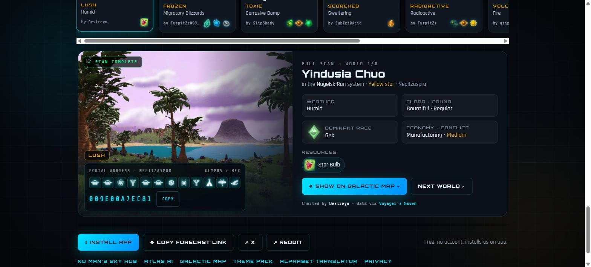
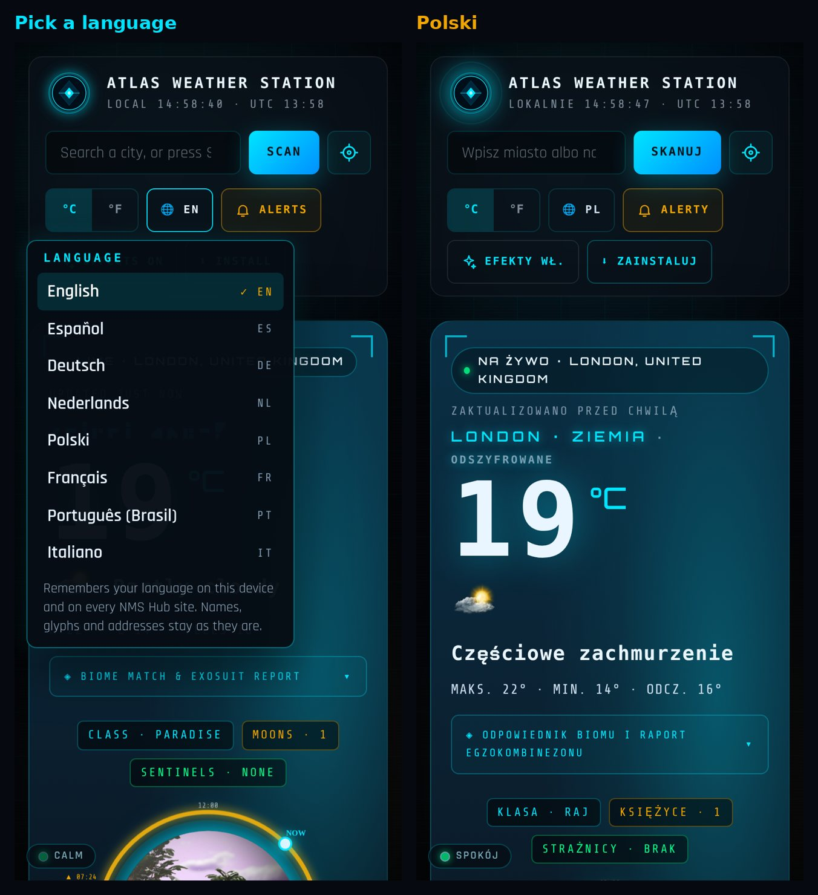
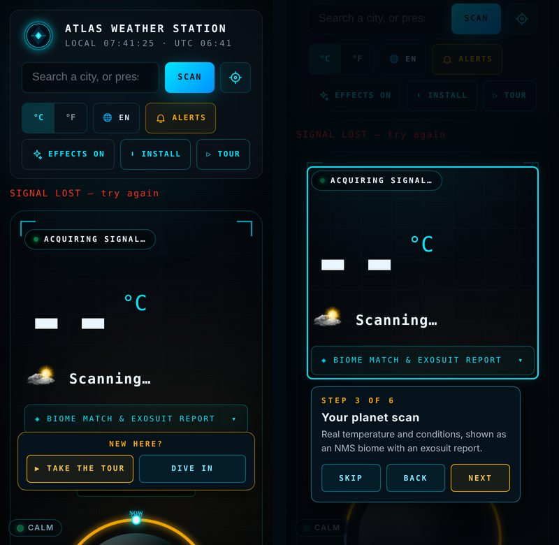

# NMS Weather — real weather as a No Man's Sky planet scan

**Live:** [weather.nomansskyhub.app](https://weather.nomansskyhub.app)

A free weather app themed on *No Man's Sky*. Your real local forecast shows up as an in-game style planet scan: the weather picks a biome, and the sky, effects and exosuit hazard readings follow it. No account, no ads, and it installs as an app on phones and desktops.

Part of the [No Man's Sky Hub](https://nomansskyhub.app) family of fan tools.

## What it does

- **Live weather as a biome.** Storms read as Extreme, snow or freezing as Frozen, rain or fog as Marsh, heat as Scorched, poor air as Toxic, high UV as Radioactive, clear nights as Barren, and everything else as Lush. The hero sky, rain/snow/lightning effects and planet image all change to match.
- **Tonight's real moon.** On clear nights the icon next to the weather is the real Moon in tonight's actual phase (worked out from the date, accurate to well under an hour, the same everywhere on Earth), turned upside down for anyone south of the equator, just as they see it. Tap it to scan: "◈ Scanning…", then the phase name and how much is lit, e.g. "◈ Full Moon · 99%", in your language. So new visitors find it, the first time the moon shows it scans itself once, and a faint cyan scan ring pulses round it until it has been tapped once (a still ring with reduced motion). The night icons in the 24-hour forecast use it too. Moon picture made from the NASA lunar map shipped with [three.js](https://github.com/mrdoob/three.js) (`icons/moon-full.png`).

  

- **Exosuit hazard protection.** "Your exosuit readings are…" Heat, cold, UV and air quality shown as shield bars using the game's own hazard icons.
- **Forecast.** Next 24 hours (temperature, rain and wind charts with sunrise/sunset), a 7-day range view, and 9 tiles grouped by what they tell you: how it feels (feels like, wind compass, humidity and dew point), the sky (rain, pressure trend, visibility), then sun and air (UV, air quality, sun path).
- **Rain radar.** An animated map of the last two hours of rain and snow around you, with play/pause and a time slider (radar by [RainViewer](https://www.rainviewer.com), map by Esri/OpenStreetMap).
- **Storm warnings.** An in-game style "Extreme weather approaching" banner with a countdown.
- **Daily planetary survey.** 8 real planets charted by players on [Voyager's Haven](https://havenmap.online), one for each biome, changing each day. Every scan shows the portal address as glyphs, the discoverer, resources, and a link to open the system on the [NMS Galactic Map](https://map.nomansskyhub.app). Any of today's worlds can be saved as a phone or desktop wallpaper on the [Theme Pack](https://theme.nomansskyhub.app/#studio-planet) (Planet of the day), which reads the same survey from here (`netlify.toml` allows `/data/` and `/hd/` to be loaded from other sites).
- **Alerts, even when the app is closed:** rain soon, extreme weather, big temperature changes, a morning briefing, an evening outlook for tomorrow (after 18:00) and the new daily survey. A scheduled Netlify function checks the forecast every 30 minutes. It needs `VAPID_PUBLIC_KEY`, `VAPID_PRIVATE_KEY` (secret) and `VAPID_SUBJECT` set on Netlify, with the same public key in `app-v2.js`. If the server can't send, the app says so and keeps alerting while it's open. A rain alert needs at least a 55% chance, or a rain/snow forecast with at least 35%, so it never fires on a 0% hour. Alerts show the app's diamond-in-ring mark in the phone's status bar (`badge-96.png`, white on transparent as Android requires). Each alert is a plain fact plus a No Man's Sky-style line picked at random for that kind of weather ("Take a coat, Traveller.", "Storm detected. Seek shelter, Traveller."), never the same line twice in a row, in the language chosen with 🌐 (`netlify/functions/lib/alert-text.mjs`). See the [privacy page](https://weather.nomansskyhub.app/privacy.html) for what is stored and how to remove it.
- **Expedition alerts:** opt in to a notification the day a new No Man's Sky expedition starts and a last call 24 hours before the current one ends (dates from the NMS Wiki's expedition list, checked by the same 30-minute function). Tapping one opens ATLAS. `?alerts=exp` opens the alert settings.
- **Major app updates.** When one of the Hub sites gets a big new feature (never for bug fixes), people who turned alerts on for that app get one short alert about it, e.g. “✨ What’s new · NMS Weather: tonight’s real moon phase…”, in their language. At most one a week per app, only between 10:00 and 20:00 UK time, and only for updates made after they signed up. Weather users can switch it off with **✨ Major app updates** in alert settings; on the other sites, turning alerts off stops it too. The notes live in `data/whats-new.json` (`id`, `date`, `apps`, `url`, `text` per language). The 30-minute checker reads that file straight from GitHub and a commit that only changes it doesn't deploy, so adding a note costs nothing.
- **Alert server for the whole Hub family.** The same two functions also send the Hub's and ATLAS's expedition alerts, the Galactic Map's "your system is trending" alerts and the Theme Pack's new-wallpapers-and-icons alerts. Those sites sign up from their own address with `nms-push.js` (same keys), so each alert arrives under that app's own name and icon.
- **Share my planet:** one tap draws today's scan as a 1080×1350 card (planet, place, temperature, biome match, exosuit report, and your Traveller ID name if you set one on the Hub) and opens the phone's share sheet; browsers that can't share files download the PNG.
- **Search or Scan.** Type a city, or press Scan with the box empty to find your location. Share a city with `?city=London`.
- °C/°F, 12/24-hour clock and an effects on/off switch for battery or motion sensitivity.
- **Calm mode.** A small **Calm** switch in the bottom-left corner swaps the patterned and image backgrounds for a plain dark one, for anyone who finds the page busy. It's shared across the whole No Man's Sky Hub family (one switch turns it on for every site) and lives in `calm.js`.
- **Your language.** The 🌐 button switches the page between English, Español, Deutsch, Nederlands, Polski, Français, Português (Brasil) and Italiano. Alerts are written in your language too. The choice is shared by the whole No Man's Sky Hub family: pick it once and every site follows (a small cookie on `.nomansskyhub.app`; when you pick a language, an anonymous count of which one is sent to the site's cookie-free GoatCounter stats, so we can see which languages people use). On a first visit the page offers your phone's language once instead of switching by itself. Names, glyphs and portal addresses stay as they are. It lives in `lang.js` (the same file on every site), with one small pack per language in `lang/` and a font for Polish letters in `fonts/`.
- **Always the newest version.** An installed app on a phone isn't reloaded when you switch back to it, so it could keep showing an old version until it was closed and reopened. Now, each time you come back to it (and every 30 minutes while it stays open), it checks for a new version. If one is live, a small bar says “New version ready · tap to update”, in your language. One tap reloads in place; × hides it. It never reloads by itself, so nothing you're in the middle of is lost. It lives in `nms-update.js`, the same file on every site.

  

- **Phone layout:** on screens 700px wide or less, a sticky jump bar (NOW · WEEK · HAZARDS · RADAR · WORLDS), the nine readings as one swipeable row with dots, and folds for the exosuit report, days 4–7, hazard readings (opened automatically when the shield drops below 100%), the rain radar and each world's full scan (opens when you tap a world). Plus a back-to-top button. It lives in `mobile.css` and `mobile.js`; desktop is unchanged. The app icon has maskable versions (`icon-maskable-*.png`) so Android doesn't show it on a white plate.

## New here? Take the tour

First-time visitors get a small **New here? ▶ Take the tour / Dive in** box (shown once, never again). The tour dims the page and spotlights city search, your location, the planet scan, alerts, the jump bar and Share, one step at a time with Back / Next / Skip. Replay it any time from the **▷ TOUR** button. The phone's Back button closes it, and it's translated into every language the site offers. Shared `nms-tour.js`, the same file on every nomansskyhub.app site.

## How it's built

A plain HTML/CSS/JavaScript site with no build step and no framework, plus two small Netlify functions for alerts. Deployed on Netlify straight from this repo.

| File | What it is |
|---|---|
| `index.html` | Page layout and styles |
| `app-v2.js` | All the app logic: weather fetch, biome rules, charts, survey, alerts |
| `sw.js` | Service worker for offline use and notifications |
| `netlify/functions/push-subscribe.mjs` | Saves or deletes an alert sign-up (Netlify Blobs) |
| `netlify/functions/push-check.mjs` | Runs every 30 minutes, checks the forecast and sends alerts |
| `netlify/functions/lib/` | Alert rules (`alerts.mjs`) and wording in 8 languages (`alert-text.mjs`, `wmo-i18n.mjs`) |
| `privacy.html` | What is stored and how to remove it |
| `lang.js`, `lang/`, `fonts/` | Language picker and translations, shared by every Hub site |
| `data/haven-worlds.json` | Snapshot of real planets from Voyager's Haven used by the daily survey |
| `icons/`, `hd/`, `glyphs/`, `fonts/` | Weather icons, planet images, portal glyphs, NMS alphabet font |

## Data and credits

- Weather and air quality: [Open-Meteo](https://open-meteo.com) (free, no key)
- Rain radar: [RainViewer](https://www.rainviewer.com); base map © Esri, HERE, Garmin, © OpenStreetMap contributors
- Place search: [OpenStreetMap Nominatim](https://nominatim.openstreetmap.org), with Open-Meteo geocoding as a fallback
- Survey planets: [Voyager's Haven](https://havenmap.online), built and run by [u/IAmThe-Ekimo-1920](https://www.reddit.com/user/IAmThe-Ekimo-1920/), with credit to each planet's discoverer
- Hazard and resource icons and planet images: the [No Man's Sky Wiki](https://nomanssky.fandom.com)
- NMS Alphabet font by seontonppa (built with FontStruct), used with permission

## Using this code?

It's free to use under the MIT licence. If you use any of it in your own project, site, video or post, please credit **elegra1965 / No Man's Sky Hub** with a link to [nomansskyhub.app](https://nomansskyhub.app). The MIT licence also asks you to keep the copyright notice in `LICENSE` with any copied code.

## Licence

The code is MIT licensed (see `LICENSE`). Game names, icons, glyphs and imagery belong to Hello Games and are not covered by that licence.

*An unofficial, fan-made project. Not affiliated with, sponsored by, or endorsed by Hello Games.*

Built by elegra1965.
